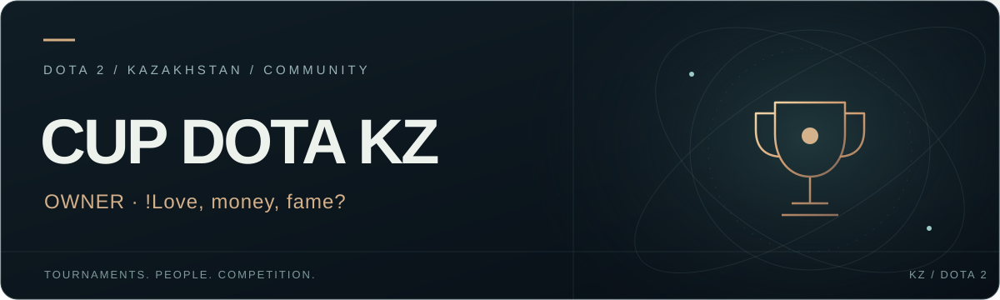

  

  <strong>DevOps · Автоматизация · Dota 2</strong> 
  Развиваю Cup Dota KZ — турнирную платформу и сообщество игроков в Казахстане.

  <a href="https://cupdota.kz"><strong>Cup Dota KZ ↗</strong></a>
  &nbsp;&nbsp;·&nbsp;&nbsp;
  <a href="https://github.com/adastanwork-afk?tab=repositories">Репозитории</a>

---

### За кулисами турниров

Мне интересно соединять инфраструктуру, автоматизацию и полезный продукт. В Cup Dota KZ занимаюсь развитием проекта, эксплуатацией сайта и интеграцией с Discord. Собираю команду, чтобы двигаться дальше вместе.

<table>
  <tr>
    <td width="33%" valign="top">
      <strong>01 / Инфраструктура</strong>  
      Запуск, окружения и проверяемые выпуски. Сначала надёжность — затем новые возможности.
    </td>
    <td width="33%" valign="top">
      <strong>02 / Автоматизация</strong>  
      Discord-интеграции и турнирные процессы. Меньше ручной рутины для игроков и организаторов.
    </td>
    <td width="33%" valign="top">
      <strong>03 / Сообщество</strong>  
      Dota 2, турниры и совместная разработка. Делаем удобные вещи для людей, которые играют рядом.
    </td>
  </tr>
</table>

### Сейчас в работе

**[Cup Dota KZ](https://cupdota.kz)** — заявки и составы, инструменты организаторов, Cup Rating и Discord-бот.

Развиваем проект небольшими шагами: понятная задача → изменение → проверка → ревью. Код основной платформы находится в закрытом репозитории.

  <code>Linux / VPS</code>&nbsp;
  <code>Git / GitHub</code>&nbsp;
  <code>CI</code>&nbsp;
  <code>Discord</code>&nbsp;
  <code>Автоматизация</code>

---

  Сообщество — в центре. Технологии — за кулисами.

